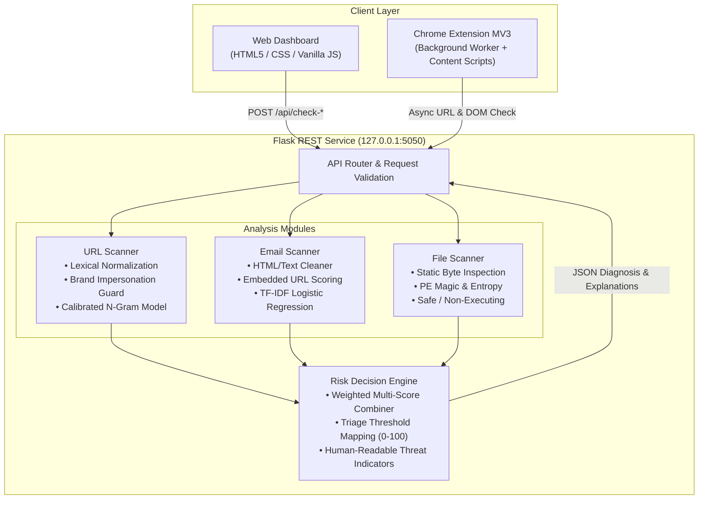

# TriGuard — Local AI Security Lab

[](https://www.python.org/)
[](https://flask.palletsprojects.com/)
[](https://scikit-learn.org/)
[](https://developer.chrome.com/docs/extensions/mv3/intro/)
[](tests/)

An end-to-end local AI security lab providing real-time threat detection and triage across three distinct attack vectors:
1. **URL Phishing Scanner**: Lexical and structural feature analysis combined with character/word n-gram models.
2. **Email Phishing Scanner**: Natural language text sanitization, TF-IDF vectorization, and calibrated Logistic Regression.
3. **Malware Static Analyzer**: Safe, non-executing static byte entropy and PE header inspection.

The system includes a local **Flask REST API (Port 5050)**, a web **Dashboard UI**, and a **Chrome/Chromium Manifest V3 Browser Extension** for automated browsing protection and Gmail message scanning.

---

## Architecture Overview



---

## Operational Modes & Triage Scale

The application supports two execution modes:

- **DEMO Mode** *(Default)*: Runs all three scanners using self-contained demo artifacts. Allows full demonstration of the dashboard, extension, and all three scanners out of the box without requiring large external datasets.
- **REAL Mode** (`APP_MODE=real`): Loads high-capacity models trained on real-world public datasets (UCI PhiUSIIL for URLs and MeAJOR for emails). In this mode, demo artifacts are never substituted. File scanning returns HTTP 503 until a real malware dataset is trained.

### Risk Triage Score (0–100)

The system assigns an application triage score rather than an raw uncalibrated probability:

| Score Range | Triage Level | Description & Handling |
| :--- | :--- | :--- |
| **0 – 29** | `SAFE` | Benign features or verified trusted domain. Minimal to no indicators found. |
| **30 – 69** | `SUSPICIOUS` | Anomalous lexical patterns or single structural alert. Caution advised. |
| **70 – 100** | `MALICIOUS` | High model confidence supported by at least two structural threat signals or verified brand impersonation. |

> [!NOTE]
> A URL requires at least two independent structural risk signals to escalate to `MALICIOUS`; otherwise, weak or moderate lexical alerts are capped at `SUSPICIOUS` to suppress false alarms on complex enterprise domains.

---

## Project Structure

```text
triguard/
├── backend/
│   ├── app.py                      # Flask REST API server (Port 5050)
│   ├── domain_utils.py             # Domain parsing & brand impersonation logic
│   ├── email_features.py           # Feature extraction for email scanner
│   ├── malware_features.py         # Static PE/byte extraction for file scanner
│   ├── risk_engine.py              # Score combiner & decision thresholds
│   ├── url_features.py             # Lexical & structural URL extraction
│   ├── requirements.txt            # Python dependencies
│   ├── train_all.py                # Model training orchestrator
│   ├── train_url_model.py          # Real URL model training script
│   ├── train_email_model.py        # Real email model training script
│   ├── train_malware_model.py      # Malware classifier training script
│   ├── prepare_url_dataset.py      # UCI dataset preparation
│   ├── evaluate_url_model_v5.py    # URL v5 challenge evaluation
│   └── models/                     # Trained model artifacts & evaluation metrics
├── frontend/                       # Web dashboard UI
│   ├── index.html                  # Responsive security dashboard
│   ├── script.js                   # Client-side API integration
│   └── style.css                   # Custom UI styling
├── extension/                      # Chrome Manifest V3 Browser Extension
│   ├── manifest.json               # Extension configuration
│   ├── background.js               # Background service worker (Navigation listener)
│   ├── content.js                  # Gmail scanner content script
│   ├── content_config.js           # Isolated Gmail DOM selectors
│   └── popup.html / popup.js       # Extension popup interface
├── tests/                          # Automated test suite
│   ├── test_project.py             # Integration & API tests
│   └── test_url_features.py        # Unit tests for URL extractors
├── data/
│   ├── processed/                  # Prepared URL training sets
│   ├── raw/                        # Active raw datasets (PhiUSIIL & MeAJOR)
│   └── hard_negative_urls*.csv     # Hard-negative evaluation challenges
├── docs/                           # Model audit reports & error analyses
├── QUICKSTART.md                   # Concise developer execution guide
└── README.md                       # Main project documentation
```

---

## Installation & Quick Run

### Prerequisites
- macOS (Apple Silicon or Intel) or Linux
- Python 3.11
- Google Chrome or Chromium (for the browser extension)

### 1. Setup Virtual Environment
```bash
# Create virtual environment
python3.11 -m venv .venv
source .venv/bin/activate

# Install dependencies
python -m pip install --upgrade pip
python -m pip install -r backend/requirements.txt
```

### 2. Start the API Server
```bash
python backend/app.py
```
The server will start at **`http://127.0.0.1:5050`**. Open this URL in your browser to interact with the dashboard.

---

## Real Model Training Pipelines

### URL Model (UCI PhiUSIIL Dataset)
Uses the [UCI PhiUSIIL Phishing URL Dataset](https://archive.ics.uci.edu/dataset/967/phiusiil%2Bphishing%2Burl%2Bdataset) (CC BY 4.0) with over 235,000 cleaned samples:
```bash
# 1. Clean raw UCI dataset and extract registrable domains
python backend/prepare_url_dataset.py

# 2. Train candidates with domain-disjoint validation and hard-negative challenges
python backend/train_url_model.py --source prepared --csv data/processed/url_training.csv --hard-negatives data/hard_negative_urls_v5.csv --candidate-version 5

# 3. Evaluate candidate against the frozen challenge set
python backend/evaluate_url_model_v5.py
```

### Email Model (MeAJOR Multi-Source Corpus)
Uses the public [MeAJOR Multi-Source Corpus](https://zenodo.org/records/18471483) with over 104,000 cleaned messages:
```bash
# 1. Download and validate corpus from Zenodo
python data/download_email_dataset.py

# 2. Train calibrated TF-IDF Logistic Regression with source-disjoint test splits
python backend/train_email_model.py --csv data/raw/phishing_emails.csv
```

### Running with Real Models
```bash
# Run with trained real models
APP_MODE=real python backend/app.py

# Run with a specific URL candidate version (v3, v4, v5, or v6)
APP_MODE=real URL_MODEL_VERSION=v5 python backend/app.py
```

---

## Chrome Extension Setup

1. Start the Flask backend server (`http://127.0.0.1:5050`).
2. Open Google Chrome and navigate to `chrome://extensions`.
3. Enable **Developer mode** (top-right toggle).
4. Click **Load unpacked** (top-left) and select the `extension/` folder from this repository.
5. **Real-time Navigation Scanning**: As you browse, navigated URLs are checked asynchronously against the API, displaying a non-blocking alert banner for suspicious or malicious URLs.
6. **Gmail Integration**: Opening any email message in Gmail extracts visible subject/body text and queries the local TriGuard API.

---

## REST API Reference

All requests and responses use JSON (except `/api/check-file` which accepts multipart form data):

| Method | Endpoint | Description | Sample Request |
| :--- | :--- | :--- | :--- |
| `GET` | `/api/health` | Healthcheck, active mode, and model metadata | *None* |
| `POST` | `/api/check-url` | Scans a URL for lexical threats & brand impersonation | `{"url": "https://paypal.com.attacker.xyz/login"}` |
| `POST` | `/api/check-email` | Scans subject and body text, including embedded URLs | `{"subject": "Urgent Action Required", "body": "Verify at https://..."}` |
| `POST` | `/api/check-file` | Scans uploaded file via static byte & PE analysis | Form field `file` (`.exe`, `.dll`, `.pdf`, `.docx`, etc.) |
| `POST` | `/api/check-multi` | Combines multiple module scores into a composite score | `{"model_scores": {"email": 80, "embedded_urls": 95}}` |

### Sample Response Format (`POST /api/check-url`)
```json
{
  "type": "url",
  "url": "http://paypal.com.attacker-domain.xyz/login",
  "prediction": "malicious",
  "risk_score": 100.0,
  "model_probability": 0.98,
  "model": "URL character n-gram + lexical classifier",
  "model_version": "6.0.0-candidate",
  "indicators": [
    "Detected potential brand impersonation of 'PayPal' inside subdomain structure."
  ],
  "reasons": [
    "Detected potential brand impersonation of 'PayPal' inside subdomain structure.",
    "URL model classified this URL as malicious."
  ]
}
```

---

## Automated Testing & Verification

The project includes unit and integration tests covering feature extraction, input validation, API responses, and risk thresholds:

```bash
# Execute test suite
pytest

# Verbose output
pytest -v
```

**Status**: 31 passed tests covering:
- Lexical URL feature extraction and Unicode/Punycode normalization
- Trusted domain allowlists and brand impersonation detectors
- Email HTML cleaning and indicator extraction
- Static PE malware feature extraction
- Risk decision thresholds and multi-score combination
- Flask API route validation and error handling (400, 413, 415, 503)

---

## Viva & Project Presentation Summary

1. **Multi-Vector Defense**: Integrates URL, Email, and File static analysis in a single unified dashboard and browser extension.
2. **False-Positive Mitigation**: Employs domain-disjoint validation splits, verified brand impersonation heuristics, and structural evidence caps.
3. **Safe File Handling**: Static-only analysis (byte entropy, PE headers, string analysis) without executing untrusted binaries.
4. **Privacy-Preserving**: No URL destinations are scraped externally; email text is analyzed entirely in memory and never persisted to logs.
